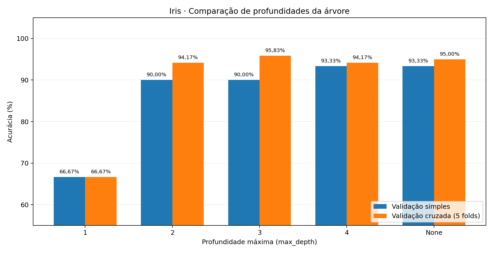
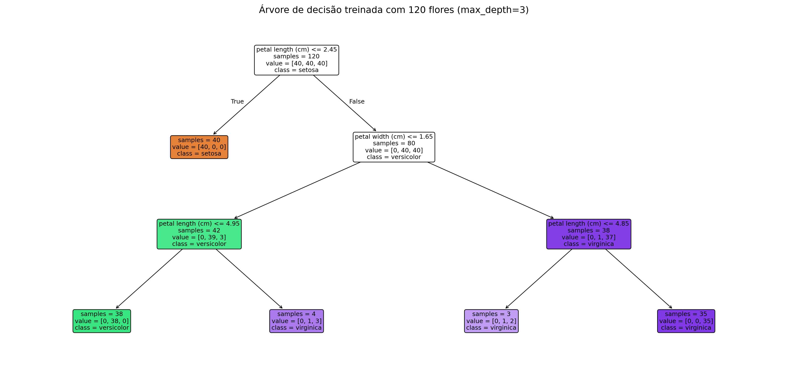

# Iris Classifier 🌸

**Meu primeiro laboratório de Machine Learning:** classificação de três espécies de flores Iris utilizando uma árvore de decisão em Python.

O objetivo é praticar o fluxo de um experimento supervisionado — desde explorar os dados e separar os conjuntos até comparar hiperparâmetros, interpretar o modelo e realizar previsões pelo terminal. **É um projeto educacional, não um sistema de identificação botânica para produção.**



## O que o projeto faz

Recebe quatro medidas em centímetros e prevê uma das espécies **setosa**, **versicolor** ou **virginica**:

1. Comprimento da sépala;
2. Largura da sépala;
3. Comprimento da pétala;
4. Largura da pétala.

Os exemplos vêm do dataset Iris disponibilizado pelo `scikit-learn` (150 amostras, três classes balanceadas e quatro atributos numéricos).

## Tecnologias

- Python 3.11+
- scikit-learn (dataset, árvore de decisão e validação cruzada)
- Matplotlib (visualização dos resultados e da árvore)
- NumPy (arrays, disponibilizado como dependência das bibliotecas acima)
- unittest (testes automatizados, incluído no Python)

## Resultados dos experimentos

Foram comparadas as profundidades `1`, `2`, `3`, `4` e `None` (`None` não estabelece um limite explícito). A comparação utilizou sempre a mesma semente aleatória (`42`).

| max_depth | Acurácia treino (90 flores) | Validação simples (30 flores) | CV estratificada 5-fold (120 flores) |
|:--|--:|--:|--:|
| 1 | 66,67% | 66,67% | 66,67% |
| 2 | 98,89% | 90,00% | 94,17% |
| **3** | **98,89%** | 90,00% | **95,83%** |
| 4 | 100,00% | 93,33% | 94,17% |
| None | 100,00% | 93,33% | 95,00% |

**Configuração selecionada: `max_depth=3`**, que obteve a maior acurácia média observada na validação cruzada. Os modelos foram treinados novamente em cada fold; após a seleção, o classificador da aplicação é treinado com as **120 amostras de desenvolvimento**.

> **Como interpretar os 95,83%?** É a média das cinco acurácias de validação cruzada para essa configuração, **não** uma garantia de desempenho com fotografias ou flores reais fora do dataset. Como o teste reservado de 30 amostras foi consultado durante o aprendizado inicial do projeto, não o apresento como avaliação final totalmente independente. Uma avaliação rigorosa exigiria preservar um teste inédito até o fim (ou coletar novos dados).

### Árvore aprendida



As decisões da árvore usam características das pétalas e sépalas; as regras são aprendidas no `.fit()`, e não codificadas manualmente.

## Como executar

1. Clone o repositório ou baixe o ZIP.
2. Abra o terminal na pasta do projeto.
3. Crie o ambiente virtual e instale as dependências.

**Windows / PowerShell** (não é necessário ativar o ambiente virtual):

```powershell
py -m venv .venv
.\.venv\Scripts\python.exe -m pip install -r requirements.txt
.\.venv\Scripts\python.exe main.py
```

**Linux / macOS:**

```bash
python3 -m venv .venv
.venv/bin/python -m pip install -r requirements.txt
.venv/bin/python main.py
```

### Exemplo de uso

```text
=== IDENTIFICADOR DE FLORES ===
Informe as quatro medidas da flor em centímetros.

Comprimento da sépala (cm): 5.2
Largura da sépala (cm): 3.6
Comprimento da pétala (cm): 1.5
Largura da pétala (cm): 0.3

=== RESULTADO ===
Espécie prevista: setosa

Probabilidades estimadas pelo modelo:
setosa: 100.00%
versicolor: 0.00%
virginica: 0.00%

Nota: essas estimativas não são garantias de acerto.
```

O programa aceita ponto ou vírgula decimal e faz um aviso quando alguma medida está fora da faixa observada no conjunto de treinamento. Esse aviso não substitui uma detecção robusta de amostras fora da distribuição.

## Reproduzir os experimentos

Execute `experimentos.py` para calcular as acurácias e recriar os gráficos e a tabela de resultados:

```powershell
.\.venv\Scripts\python.exe experimentos.py
```

No Linux/macOS, use `.venv/bin/python experimentos.py`.

Os arquivos produzidos ficam em `assets/`:

- `comparacao-modelos.png`: comparação entre validação simples e cruzada;
- `arvore-decisao.png`: regras do classificador final;
- `resultados.csv`: acurácias reprodutíveis de cada configuração.

Para rodar os testes:

```powershell
.\.venv\Scripts\python.exe -m unittest discover -s tests -v
```

Os quatro testes também são executados automaticamente pelo **GitHub Actions** a cada `push` ou abertura de pull request.

## Estrutura do repositório

```text
iris-ml-classifier/
├── assets/
│   ├── arvore-decisao.png
│   ├── comparacao-modelos.png
│   └── resultados.csv
├── tests/
│   └── test_main.py
├── .github/
│   └── workflows/
│       └── tests.yml
├── .editorconfig
├── .gitignore
├── experimentos.py
├── main.py
├── requirements.txt
└── README.md
```

## O que aprendi

- Diferença entre **features** (`X`) e **target** (`y`);
- Aprendizado supervisionado com **árvores de decisão**;
- Separação estratificada de treino, validação e teste;
- **Acurácia**, **matriz de confusão**, **underfitting** e **overfitting**;
- Seleção de `max_depth` via **validação cruzada estratificada**;
- **Inferência** com `.predict()` e probabilidades estimadas com `.predict_proba()`;
- Limitações de um classificador com entradas muito diferentes das usadas no treinamento.

## Limitações e próximos passos

- O classificador usa **medidas**, não fotografias; reconhecimento por imagem exigiria outro pipeline e dados de imagens.
- `predict_proba()` estima proporções de classes nas folhas da árvore; 100% **não significa certeza**.
- Dataset pequeno e balanceado: o desempenho pode não se repetir em dados reais.
- Apenas um algoritmo foi estudado. Futuros experimentos podem comparar outros classificadores e avaliar calibração de probabilidades.
- O teste de 30 flores já foi observado durante o laboratório; não o uso como métrica definitiva de generalização.

---

**Projeto educacional de preparação para estudos em Machine Learning Engineering.**

Dataset: [Iris — documentação do scikit-learn](https://scikit-learn.org/stable/modules/generated/sklearn.datasets.load_iris.html).
